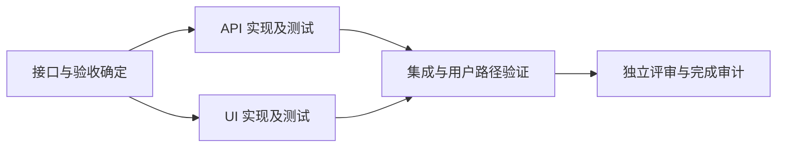

# claudex

Claude Code / Codex 的独立开发配置。目标是完整实现需求，让架构、代码和执行过程保持清楚：抽象有真实用途，在边界校验输入，意外错误保留原因，完成必须有可检查的结果。

| 命令 | 用户配置 | 行为 |
| --- | --- | --- |
| `claude` | 原生默认配置 | 保留你原来的 Claude Code 设置 |
| `codex` | 原生默认配置 | 保留你原来的 Codex 设置 |
| `claude-dev` | `~/.claude-dev/` | 加载本项目的开发规则、角色和技能 |
| `codex-dev` | `~/.codex-dev/` | 加载相同的开发规则、角色和技能 |

普通命令仍按各自 CLI 的原生规则处理环境变量和项目配置。这里的“默认”是你已有的原生配置，不会重置个人设置。

## 安装与使用

安装需要 POSIX sh 和 Bun（已验证 **1.3.14**）；运行开发入口还需要相应原生 CLI 在 `PATH` 中。安装器使用 TypeScript 与内置 API，不需要 Python 或安装第三方包。已验证 Claude Code **2.1.268**、Codex CLI **0.154.0**。更早版本未做兼容性保证，尤其要确认 Codex 支持独立 agent TOML 和配置目录内的技能发现。

```bash
git clone https://github.com/NEX-S/claudex.git
cd claudex
./install.sh
```

安装两个可执行入口到 `~/.local/bin`。如果该目录不在你的 `PATH`，在 shell 配置中加入：

```bash
export PATH="$HOME/.local/bin:$PATH"
```

之后在项目目录中使用：

```bash
claude-dev
codex-dev
codex-dev exec '修复当前失败的测试，并验证实际行为'
```

参数、工作目录和退出码透传给原生 CLI。wrapper 只为子进程设置相应的开发配置根并 `exec` 原生命令，安装时不会改变 shell 别名。`claude-dev` 另有固定锚点：会话以 `--permission-mode bypassPermissions --effort max --autocompact 900k` 启动（你写在后面的同名参数仍然覆盖），且 `--model` 的值同时写入原生模型别名和 subagent 模型，避免内建 subagent 解析到端点不服务的 Anthropic 模型 id；不传 `--model` 时这些变量不设置。`codex-dev` 不设置这些。

开发配置的登录、个人服务设置和历史独立维护，首次使用可能需要登录：

```bash
claude-dev auth login
codex-dev login
```

自定义 provider、MCP 或其他个人设置按原生格式放入 `~/.claude-dev/settings.json`、`~/.codex-dev/config.toml` 等对应文件。安装器不复制默认目录的认证或设置，升级也保留开发目录内无关的个人文件。已导出的 API 环境变量仍按原生行为生效。

配置隔离通过官方的 [`CLAUDE_CONFIG_DIR`](https://code.claude.com/docs/en/claude-directory) 和 [`CODEX_HOME`](https://learn.chatgpt.com/docs/config-file/config-advanced#config-and-state-locations) 实现。项目中的 `CLAUDE.md`、`AGENTS.md`、项目配置和 CLI 本身支持的共享技能路径仍会被读取；这不是文件系统隔离。不会把本项目的技能安装到普通 Codex 也会发现的 `~/.agents/skills`。

测试或预览安装到另一个目录：

```bash
./install.sh --home /tmp/claudex-preview
/tmp/claudex-preview/.local/bin/claude-dev --version
/tmp/claudex-preview/.local/bin/codex-dev --version
```

`--home` 只指定安装目的根，不改进程 `HOME`。生成的 wrapper 固定指向该安装目录；移动安装后应重新运行安装器。支持 `~` 和 `~/path`；其他用户的 `~name` 路径应由 shell 展开或写成绝对路径。

## 规范如何分层

| 内容 | 责任 | 何时加载 |
| --- | --- | --- |
| 根规范 | 完整目标、最少必要结构、边界契约、错误可见、验证责任 | 每次开发会话 |
| `arch` | 真实架构决策、接口与依赖 | 设计尚未确定时 |
| `dev` | 实现、修复及必要验证 | 有明确需求或设计时 |
| `review` | 独立只读检查正确性、回归、复杂度和验证缺口 | 变更需要独立审查时 |
| `research` | 对未知领域收集证据并比较取舍 | 方案需要研究时 |
| `refine` | 对已有基线做受控实验 | 有可衡量的优化目标时 |
| `plan` | 把已定方案写成有依赖、所有权和验收的计划 | 工作复杂或需恢复时 |
| `orchestrate` skill | 计划、并行派发、集成、失败和恢复契约 | 执行多任务计划时 |
| `author-skills` skill | 技能作用域、按需资源和行为验证 | 编写或修订技能时 |

简单修改直接做。跨独立领域的研究可以并行；接口和文件所有权定下来后，再并行开发。不会给所有任务强制套完整流水线、固定角色数量或“失败两次就清空会话”。

“少校验、少错误处理”有明确边界：拒绝无效外部输入、资源清理、已知可恢复错误仍按需求处理；内部可信代码不重复同一校验；未知异常不能被空值、默认成功、宽泛捕获或无限重试掩盖。

## 计划定稿后并行执行

可以直接用自然语言：

```text
Goal: 给现有应用增加可导出的筛选结果。
Context: 相关接口在 src/api，界面在 src/ui，已有验证命令见项目说明。
Constraints: 复用当前依赖，保持现有 API 兼容。
Done when: 从真实界面筛选并导出的内容一致，相关回归通过。

先解决会影响接口的设计问题。方案确定后用 plan 写 plan.md，
然后使用 orchestrate 执行；独立任务并行，集成后验收。
```

Claude 可显式输入 `/orchestrate`，Codex 可输入 `$orchestrate`；技能也可按描述自动选择。格式契约见 [plan-format.md](templates/skills/orchestrate/references/plan-format.md)。

每项任务有稳定 `id`、`role`、`deps`、`owns`、`acceptance`、`state`。协调者只派发前驱完成、文件与共享资源不冲突的就绪任务，并记录真实运行句柄。A 完成后 B/C 可并行，D 只能消费两者集成并验收后的结果：



共享工作区由一个任务拥有一个写入范围；需要分支隔离时使用 worktree，协调者串行集成。任务完成即重新计算就绪集合，不等无关慢任务。失败只阻塞受影响的后继。`done` 必须有后继能访问的集成产物和验收证据，worker 的完成消息不足以解锁任务。

中断后让 agent 读取 `plan.md` 并使用 `orchestrate` 恢复。它先核对仓库和实际运行句柄；超时或陈旧的 `running` 记录不能作为重复启动 worker 的理由。计划是协调记录，不代替实际文件、进程和验证结果。运行仍由原生会话承担，本项目不安装常驻调度器，也不承诺退出 CLI 后自动继续。

默认使用原生 subagents。稳定、重复且适合脚本化的流程，可由 `orchestrate` 选择当前环境提供的 [Claude 原生 Workflows](https://code.claude.com/docs/en/workflows)，先加载原生 `workflow-authoring` 参考并确认角色加载与模型继承。其脚本运行于 Claude 的受限 JavaScript 环境；Bun 仅运行本项目安装器。Workflows 的失败或 `null` 结果仍需保留，恢复可能重跑已完成工作，不能替代文件集成与验收。当前没有发布通用 workflow 脚本，也未验证本地 provider 的 Workflow 执行；具体选型见[研究报告](docs/research-orchestration.md)。

## 更新与旧版本迁移

更新仓库后重新运行 `./install.sh`。内容未变则不重写、不新增备份；受管内容有变化会先备份。两端角色只维护 [templates/agents](templates/agents) 一份 Markdown，安装时生成 Codex TOML，模型等设置由父会话继承。当前 Codex 原生支持 [standalone agent TOML](https://learn.chatgpt.com/docs/agent-configuration/subagents#custom-agents)。

旧版曾写入 `~/.claude` 和 `~/.codex`，迁移需移走这些旧指令才能使普通命令恢复原来用途。安装器按仓库历史发布内容的精确指纹识别：

- 可确认的旧发布文件移至备份目录，保持原始字节与相对路径；旧转发和符号链接还会核对目标关联。
- 用户改写、未知内容或未知链接保留，安装输出列明仍需处理的路径。这种情况下普通命令可能继续加载旧规范，不能视为迁移全部完成。
- 不清空默认目录，不改个人认证、settings/config，不猜测哪个旧 `.bak.*` 是你希望恢复的版本。

备份位置由安装输出给出，位于安装根下的 `.local/state/claudex/backups/`，内部保留 `.claude/`、`.codex/`、`.claude-dev/` 等原路径。需要恢复时，先检查备份与现文件，再将所需条目放回原位置；链接应按链接恢复。恢复旧全局指令也会恢复普通命令加载开发规范的行为。

新安装仅创建开发目录和两个入口。归档下载也能安装，迁移指纹随仓库发布，不依赖安装机器保留 Git 历史。安装器会拒绝将受管目录通过符号链接映射到其他位置，避免更新开发配置时写进默认目录。

## 验证与研究

维护者测试另外需要 Python 3.11+；保留标准库 `unittest` 与 `tomllib` 作为独立行为和生成格式验证。安装本身仅需 Bun 与 sh。

```bash
python3 -m unittest discover -s tests -v
CLAUDEX_TEST_CLI=1 python3 -m unittest discover -s tests -p test_cli.py -v
git diff --check
```

第一条运行安装行为和内容契约检查；第二条需要两端 CLI，通过本地模拟模型检查实际安装内容是否进入请求、普通配置是否保持独立，不消耗云模型调用。未设置 `CLAUDEX_TEST_CLI=1` 时原生 CLI 检查跳过；缺少某个 CLI 时也会明确跳过，对应端不能算验证通过。

- [Prompt / context / harness 研究](docs/research-harness.md)：官方证据、常驻与按需规则、8 类真实质量评估任务。
- [任务图与 skills 研究](docs/research-orchestration.md)：并行与恢复语义、技能编写方法及平台边界。
- [设计决策](docs/design.md)：取舍、安装契约与验收范围。
- [验证记录](docs/validation.md)：具体命令、原生并行、技能行为及未验证范围。

这些规范以更少的重复规则和更明确的验收支持开发质量；模板简短、格式有效或单次评审通过都不能证明所有项目的质量和速度会提高。新旧配置的多次同条件对照应按研究中的评估方法继续积累。
